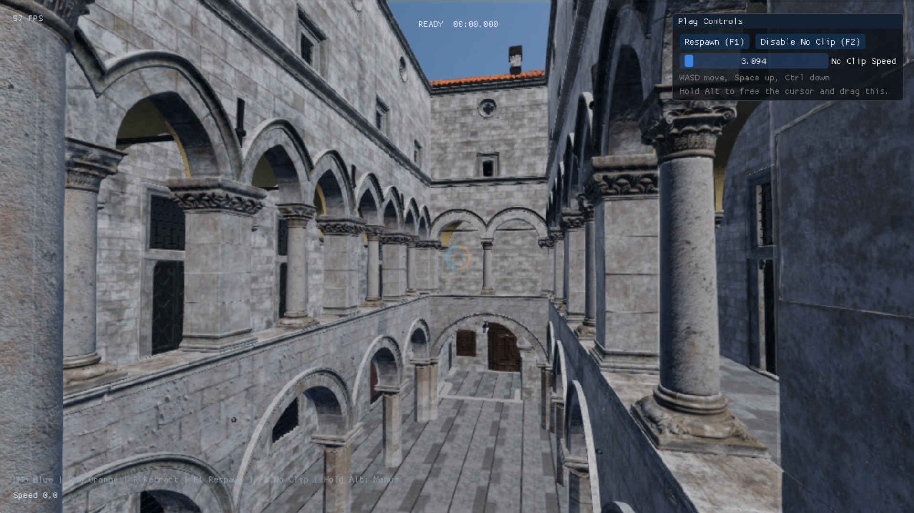
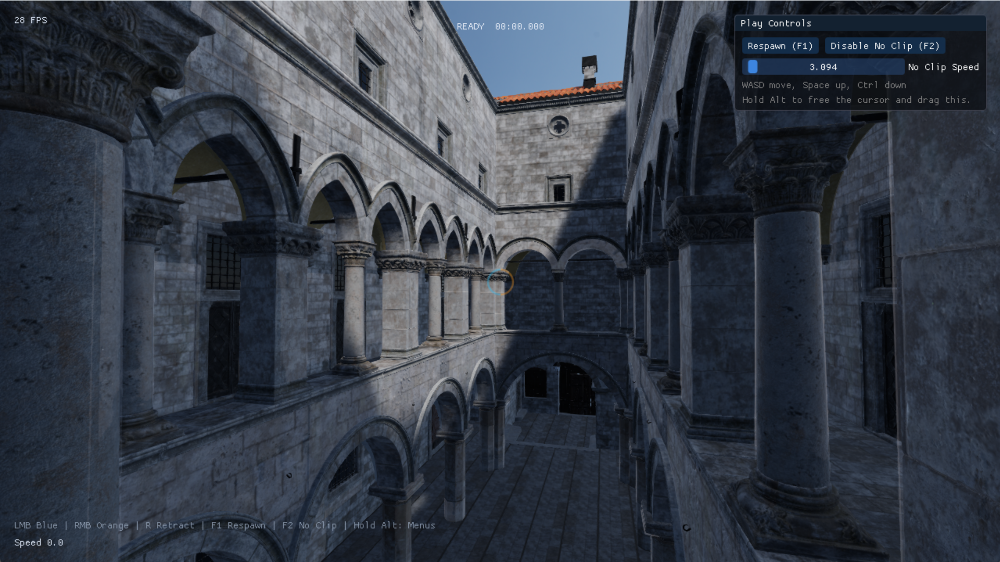
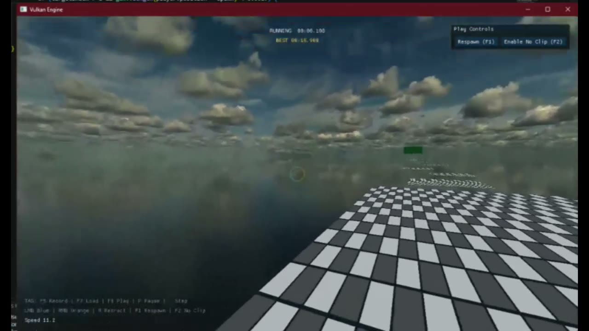

# Mirabilis

Mirabilis is a C++20/Vulkan engine prototype for editor-authored scenes, Source/Quake-style movement, and momentum-preserving player portals. It combines an EnTT scene system, Jolt rigid-body physics, and C# gameplay scripts that can reload while the scene keeps running.

[Watch the project demo](https://kennynguyen216.github.io/portfolio/media/mirabilis-milestone2-demo.mp4) | [View my portfolio](https://kennynguyen216.github.io/portfolio/) | [C# scripting guide](docs/scripting.md)

## Latest captures

### Real-time shadow pass

| Before | After |
| --- | --- |
|  |  |

[Watch before shadows](docs/media/mirabilis-before-shadows.mp4) · [Watch the shadow pass](docs/media/mirabilis-after-shadows.mp4)

### Timed movement course

[](docs/media/mirabilis-movement-time-trial.mp4)

Click the preview to watch the run.

## Highlights

### Vulkan rendering

- Renders GPU mesh and material pipelines with glTF/GLB scene loading.
- Manages Vulkan command buffers, synchronization, descriptor sets, dynamic rendering, and swapchain presentation.
- Includes real-time shadows, ambient occlusion, and screen-space global illumination, with experimental probe/SDF lighting and a software path-tracing reference mode.
- Includes a compute-rendered background and ongoing portal-rendering experiments.

### Linked portals

- Uses stencil-mask passes to restrict linked-world rendering to each visible portal surface.
- Includes an experimental recursive stencil path for a linked portal visible through another portal.
- Places portals on eligible walls, carves portal-shaped openings from collision, and rejects overlapping or invalid placements.
- Transforms player position, velocity, and view orientation through linked portal frames while preserving momentum.
- Keeps the player’s blue/orange portal-gun pair transient, while scene-authored freestanding portal links persist independently. Up to seven linked editor pairs can be placed and loaded per scene.

### Scene editor and tooling

- Uses EnTT entities with versioned identities, hierarchical transforms, and deferred scene changes.
- Provides an ImGui editor with a scene hierarchy, object inspector, selection, duplication, and deletion.
- Supports translate, rotate, and scale gizmos with optional snapping.
- Exposes editable box colliders and gameplay roles for scene-authored objects.
- Saves and loads scene hierarchies, transforms, colliders, rigid bodies, scripts, imported assets, and gameplay roles in version 2 JSON scenes.

### Jolt physics

- Integrates static and dynamic rigid bodies, gravity, contact, friction, restitution, forces, and impulses.
- Exposes body settings in the inspector and synchronizes simulated transforms with scene rendering, interpolation, and motion history.
- Restores the authored scene when leaving or resetting Play, and keeps visual children attached to moving bodies.

### C# scripting and hot reload

- Hosts .NET 10 scripts with `OnCreate`, `OnFixedUpdate`, `OnUpdate`, and `OnDestroy` callbacks.
- Exposes entity references, transforms, input, logging, and rigid-body commands through a managed API, with editable public fields in the inspector.
- Builds saved user-script changes in the background and reloads them during Play, preserving the live scene, physics state, and supported public/private fields.
- Keeps the previous working scripts running when compilation or reload fails. ScriptCore and native C++ changes require a restart.

### Movement and time trials

- Runs Source/Quake-inspired movement on a fixed timestep with acceleration, friction, air control, jump buffering, and bunny hopping.
- Supports surf ramps and scene-authored spawn points, start triggers, finish triggers, and a timer HUD.

## Technology

- **Languages:** C++20, C# / .NET 10
- **Graphics:** Vulkan, GLSL
- **Scene entities:** EnTT
- **Rigid-body physics:** Jolt Physics
- **Platform and input:** SDL2
- **Editor UI:** ImGui and ImGuizmo
- **Assets and math:** fastgltf, simdjson, GLM, stb_image
- **Build:** CMake

EnTT, Jolt, SDL2, fmt, vk-bootstrap, VMA, GLM, ImGui, ImGuizmo, fastgltf, simdjson, and other supporting libraries are included under `third_party/`. EnTT provides entity storage and Jolt provides rigid-body simulation; Mirabilis implements their scene lifecycle, editor, rendering, and gameplay integration, alongside its movement, portals, and .NET host.

## Build and run

### Requirements

The current build targets Windows x64. Install:

- Git
- CMake 3.21 or newer
- Visual Studio with the **Desktop development with C++** workload and a C++20-capable compiler
- The [Vulkan SDK](https://vulkan.lunarg.com/sdk/home/)
- The x64 .NET 10 SDK, including the Windows x64 hosting pack

A Vulkan 1.3-capable GPU is required for the editor. The .NET SDK includes the runtime needed by scripts; the SDK is also required to compile scripts and build the native host.

The Vulkan SDK installer should configure the `VULKAN_SDK` environment variable. Restart your terminal after installing it.

### Clone

Keep the checkout and build output outside OneDrive or other synced folders. For example:

```powershell
git clone https://github.com/kennynguyen216/Mirabilis.git C:/dev/Mirabilis
cd C:/dev/Mirabilis
```

### Configure and build

```powershell
cmake -S . -B build
cmake --build build --config Debug --parallel
```

CMake builds and deploys ScriptCore, the sample scripts, and the hosting DLL beside the executable automatically.

### Run

```powershell
Push-Location .\bin\Debug
.\engine.exe
Pop-Location
```

Press `Esc` or close the window to exit.

## Status

ECS scenes, Jolt physics, C# scripting, and live script reload are implemented and validated. Mirabilis remains an active engine and rendering prototype, with experimental lighting paths and a deliberately limited gameplay API.

Dynamic rigid bodies currently use root-level box colliders. The player retains its dedicated movement controller, and rigid bodies do not yet travel through portals. Hot reload preserves the six supported field types; complex object graphs and collections are not migrated. See the [scripting guide](docs/scripting.md) for the supported API and reload behavior.

Ambient occlusion has a persistent **Globally Enabled** switch and quality/
blur preferences in Render Settings. These are saved in SDL's per-user
Mirabilis directory (`ambient_occlusion.cfg`) and shared by Debug and Release.
Loading a scene does not change them. Scenes without an `ssao` block use the
project defaults (radius 0.75, normal offset bias 0.075, intensity 1, power 1.5).
Enable **Override For This Scene** to edit and save level-specific values;
**Reset to Project Defaults** removes that override on the next scene save.
Existing scene `ssao` blocks remain explicit overrides.

