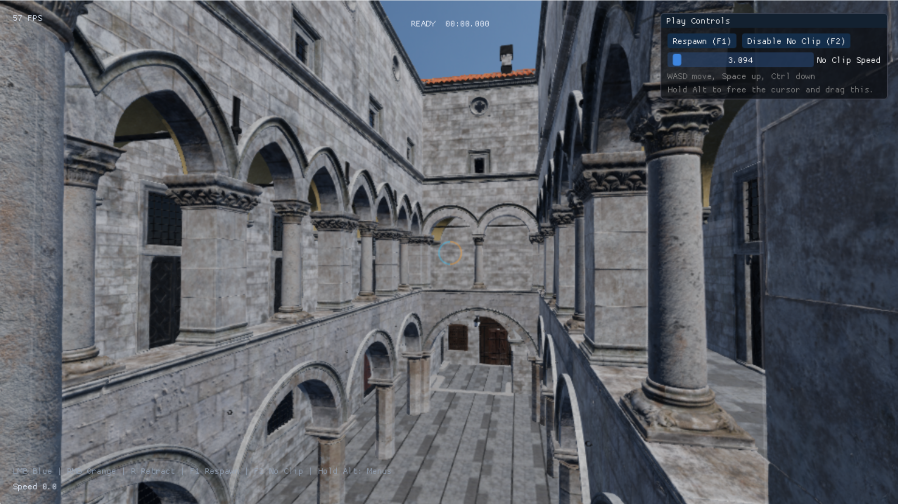
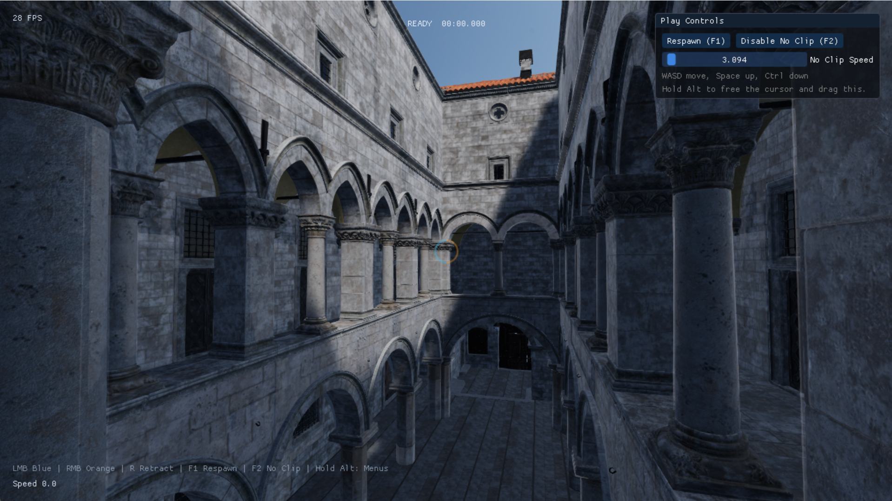
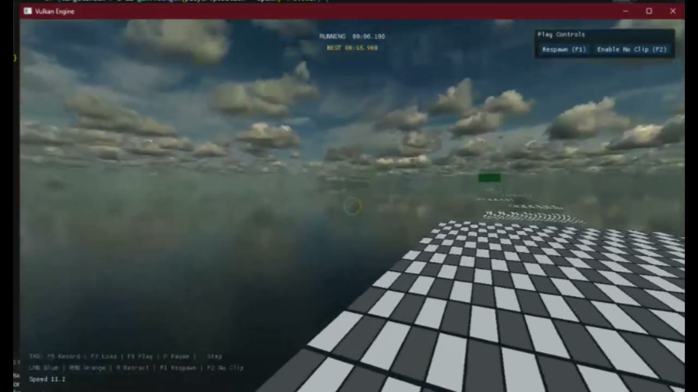

# Mirabilis

Mirabilis is a C++20/Vulkan engine prototype for editor-authored scenes, Source/Quake-style movement, and momentum-preserving player portals. It combines an EnTT scene system, Jolt rigid-body physics, and C# gameplay scripts that can reload while the scene keeps running.

[Watch the project demo](https://kennynguyen216.github.io/portfolio/media/mirabilis-milestone2-demo.mp4) | [View my portfolio](https://kennynguyen216.github.io/portfolio/) | [C# scripting guide](docs/scripting.md)

## Latest captures

### Real-time shadow pass

| Before | After |
| --- | --- |
|  |  |

[Watch before shadows](docs/media/mirabilis-before-shadows.mp4) · [Watch the shadow pass](docs/media/mirabilis-after-shadows.mp4)

### Timed movement course

[](docs/media/mirabilis-movement-time-trial.mp4)

Click the preview to watch the run.

## Highlights

### Vulkan rendering

- Renders GPU mesh and material pipelines with glTF/GLB scene loading.
- Manages Vulkan command buffers, synchronization, descriptor sets, dynamic rendering, and swapchain presentation.
- Includes real-time shadows, ambient occlusion, and screen-space global illumination, with experimental probe/SDF lighting and a software path-tracing reference mode.
- Includes a compute-rendered background and ongoing portal-rendering experiments.

### Linked portals

- Uses stencil-mask passes to restrict linked-world rendering to each visible portal surface.
- Includes an experimental recursive stencil path for a linked portal visible through another portal.
- Places portals on eligible walls, carves portal-shaped openings from collision, and rejects overlapping or invalid placements.
- Transforms player position, velocity, and view orientation through linked portal frames while preserving momentum.
- Keeps the player’s blue/orange portal-gun pair transient, while scene-authored freestanding portal links persist independently. Up to seven linked editor pairs can be placed and loaded per scene.

### Scene editor and tooling

- Uses EnTT entities with versioned identities, hierarchical transforms, and deferred scene changes.
- Provides a Qt host with an embedded Vulkan viewport, dockable content browser, scene tree, name/transform properties, and selection/duplicate/delete actions.
- Keeps ImGui for profiler, render settings, and component diagnostics; advanced component controls remain there during the Qt properties migration.
- Supports translate, rotate, and scale gizmos with optional snapping.
- Exposes editable box colliders and gameplay roles for scene-authored objects.
- Saves and loads scene hierarchies, transforms, colliders, rigid bodies, scripts, imported assets, and gameplay roles in version 2 JSON scenes.

### Jolt physics

- Integrates static and dynamic rigid bodies, gravity, contact, friction, restitution, forces, and impulses.
- Exposes body settings in the inspector and synchronizes simulated transforms with scene rendering, interpolation, and motion history.
- Restores the authored scene when leaving or resetting Play, and keeps visual children attached to moving bodies.

### C# scripting and hot reload

- Hosts .NET 10 scripts with `OnCreate`, `OnFixedUpdate`, `OnUpdate`, and `OnDestroy` callbacks.
- Exposes entity references, transforms, input, logging, and rigid-body commands through a managed API, with editable public fields in the inspector.
- Builds saved user-script changes in the background and reloads them during Play, preserving the live scene, physics state, and supported public/private fields.
- Keeps the previous working scripts running when compilation or reload fails. ScriptCore and native C++ changes require a restart.

### Movement and time trials

- Runs Source/Quake-inspired movement on a fixed timestep with acceleration, friction, air control, jump buffering, and bunny hopping.
- Supports surf ramps and scene-authored spawn points, start triggers, finish triggers, and a timer HUD.

## Technology

- **Languages:** C++20, C# / .NET 10
- **Graphics:** Vulkan, GLSL
- **Scene entities:** EnTT
- **Rigid-body physics:** Jolt Physics
- **Platform and input:** SDL2
- **Editor UI:** Qt 6 Widgets; ImGui diagnostics and ImGuizmo viewport tools
- **Assets and math:** fastgltf, simdjson, GLM, stb_image
- **Build:** CMake

EnTT, Jolt, SDL2, fmt, vk-bootstrap, VMA, GLM, ImGui, ImGuizmo, fastgltf, simdjson, and other supporting libraries are included under `third_party/`. EnTT provides entity storage and Jolt provides rigid-body simulation; Mirabilis implements their scene lifecycle, editor, rendering, and gameplay integration, alongside its movement, portals, and .NET host.

## Build and run

### Requirements

The current build targets Windows x64. Install:

- Git
- CMake 3.21 or newer
- Visual Studio with the **Desktop development with C++** workload and a C++20-capable compiler
- The [Vulkan SDK](https://vulkan.lunarg.com/sdk/home/)
- The x64 .NET 10 SDK, including the Windows x64 hosting pack
- Qt 6.8 or newer, MSVC x64 Widgets SDK (tested with 6.12); CMake deploys its runtime plugins

A Vulkan 1.3-capable GPU is required for the editor. The .NET SDK includes the runtime needed by scripts; the SDK is also required to compile scripts and build the native host.

The Vulkan SDK installer should configure the `VULKAN_SDK` environment variable. Restart your terminal after installing it.

### Clone

Keep the checkout and build output outside OneDrive or other synced folders. For example:

```powershell
git clone https://github.com/kennynguyen216/Mirabilis.git C:/dev/Mirabilis
cd C:/dev/Mirabilis
```

### Configure and build

```powershell
cmake -S . -B build -DCMAKE_PREFIX_PATH=C:/Qt/6.12.0/msvc2022_64
cmake --build build --config Debug --parallel
```

CMake builds and deploys ScriptCore, the sample scripts, and the hosting DLL beside the executable automatically.

Alternatively, with Ninja installed, use the shared presets from a Visual Studio
Developer PowerShell:

```powershell
cmake --preset windows -DCMAKE_PREFIX_PATH=C:/Qt/6.12.0/msvc2022_64
cmake --build --preset debug --parallel 2
ctest --preset debug
```

Use `release` for Release builds/tests. The `windows-core` configure preset and
`core-debug` / `core-release` build/test presets run the CPU and managed checks
without Vulkan or UI dependencies. Keep machine-specific settings in the ignored
`CMakeUserPresets.json`. Build configurations sequentially: they share runtime
deployment and generated shader outputs.

### Run

```powershell
Push-Location .\bin\Debug
.\engine.exe
Pop-Location
```

The Qt editor opens by default. Its content browser navigates the asset root,
filters the current folder, previews selected images, opens scene JSON files,
imports glTF/GLB models, assigns a selected image as base color, and reimports
models. Asset changes apply on the engine thread in Edit mode. Reimport builds
replacement resources before swapping; failed parses/textures retain the old model.
Save/Discard/Cancel protects unsaved scenes on open and close.

Use **Debug > ImGui diagnostics** for profiling, rendering controls and the
advanced component inspector. Qt currently edits names and transforms; physics,
scripts and other advanced component controls remain in that debug inspector.
`MIRABILIS_ASSET_ROOT` overrides the browser root. The existing scene directory
is `assets/scenes`; browsing does not rename or move files and break references.

`MIRABILIS_QT_EDITOR=0` runs the SDL host. Configure with
`-DMIRABILIS_BUILD_QT_EDITOR=OFF` to omit the Qt dependency entirely. Bounded
GPU tests use SDL unless Qt is explicitly enabled. Press `Esc` or close to exit.

### Profiling and shared services

The **Profiler** debug window is available with the editor's debug panels. CPU
profiling is off by default. Enable it to inspect the last completed host frame,
inclusive operation times and call counts, and a bounded frame history. Timings
include waits; they are not CPU utilization measurements. GPU timings reuse the
existing completed queries. GPU allocation statistics are sampled only when
requested, and draw-index scratch capacity/growths show retained CPU memory.

Use **Start trace**, **Stop trace** and **Save trace** to export
`mirabilis-profile.json` in the working directory. Captures retain at most 65,536
events and report dropped events when full. Starting a new capture discards the
previous capture. Export copies a consistent snapshot before writing it; tracing
adds synchronization overhead and should be disabled for ordinary performance
comparisons.

For an unattended trace including startup, set an output path whose parent exists:

```powershell
New-Item -ItemType Directory -Force .\tmp | Out-Null
$env:MIRABILIS_PROFILE_TRACE = Join-Path $PWD "tmp/profile.json"
Push-Location .\bin\Debug
.\engine.exe
Pop-Location
Remove-Item Env:\MIRABILIS_PROFILE_TRACE
```

`MIRABILIS_PROFILE=1` enables CPU summaries without tracing. Trace JSON contains
CPU duration events and counters, with timestamps/durations in microseconds.
GPU counters are reported when completed results are received; they do not claim
to locate GPU work on the CPU timeline. A failed requested trace export reports
an error rather than claiming a successful capture.

`FrameClock` and `Profiler` live in the GPU-free core. The frame clock preserves
unclamped wall time and caps simulation deltas at 100 ms; reload resets its time
origin. `VulkanEngine::tick_simulation` shares the existing fixed-step update and
accepts input-focus permission from the host without pumping events or calling
ImGui. The Qt host pumps on the owner thread before simulation and shares these
services with the SDL fallback.

The core task scheduler uses pinned worker fibers, priority queues, nested
`TaskGroup` waits and `parallel_for`. Windows x64 uses a separate MASM switch
preserving nonvolatile registers, floating-point controls and stack metadata.
Processes with hardware shadow stacks use Win32 fibers automatically. Waiting
jobs retain their scratch storage; exhausted fiber pools execute descendants on
the worker root stack with a checked nesting limit. Exceptions propagate after
joining the group, cancellation skips queued work, and shutdown drains accepted
jobs and their children. Callers must join groups before captured references die;
cyclic dependencies are invalid. A task must not shut down its own scheduler.

`VirtualArena` reserves address space and commits pages on demand, supports
checked alignment/reallocation and scoped rewinds, and can decommit on reset.
`FixedBlockPool` reuses aligned slots and rejects invalid/double releases.
`SizeClassResource` serves 16–2048-byte allocations from pools, with heap fallback
for larger/over-aligned requests. Task queues use these pools; larger tangent jobs
use per-task PMR scratch with heap fallback when its arena fills. Arena reset
never runs destructors: PMR containers must be destroyed first. Profiling reports
committed task scratch and small-pool memory; heap fallback allocations are not
included in those figures.

The glTF loader decodes only referenced images in batches of two on workers,
reuses one decode for sRGB/linear GPU variants, and performs Vulkan uploads on the
owner thread. Each decoded RGBA source is limited to 256 MiB; unsupported or failed
images use the checkerboard on initial load. Embedded image views honor their byte
offsets and lengths. This reduces duplicate decoding and temporary allocation;
no frame-rate or load-time speedup is claimed without a dedicated benchmark.

After building, run the profiling GPU gate sequentially with other GPU checks:

```powershell
python tests/profiling_gate.py --output C:/temp/mirabilis-profile-check
```

Use a fresh output directory. The gate checks engine trace events, steady scratch
capacity, unchanged scene files, and identical profiling-on/off raster captures
in a static scene and during player portal traversal. Add `--configuration Release`
to exercise the Release binary.

The Qt integration gate uses disposable assets and saved scenes:

```powershell
python tests/qt_editor_gate.py --output C:/temp/mirabilis-qt-check
```

It checks import, shared color-space decodes, embedded image offsets, texture
assignment/failure, transforms, save/reopen, stale identities, reimport, dock/
window lifecycle behavior, ImGui diagnostics in Edit/Play and close Cancel/Discard. Native CTest coverage also exercises both fiber
backends, pool exhaustion, nested tasks, cancellation, shutdown and allocator
alignment/overflow/OOM paths.

### Comparing engine performance

Build both checkouts in Release with matching assets and generated shaders, then
run GPU workloads sequentially with the comparison harness:

```powershell
python tests/benchmark_comparison.py --baseline C:/dev/Mirabilis-baseline --candidate . --output C:/temp/mirabilis-comparison
```

Use a fresh output directory. The harness verifies matching shader/asset bytes
and rendered captures, primes caches, then alternates five old/new runs in the
sandbox, Sponza and a portal scene. Each run uses a fixed 1600×900 window, the
scene's saved quality settings, 120 warm-up frames and 600 measured frames with
the cap/panels/profiling off. It requires input focus for every measured sample.
Window focus changes invalidate a run. No other engine instance or build should
run during measurement.

Results include wall-frame FPS, run variance, descriptive paired bootstrap
intervals, render-loop duration percentiles, startup/glTF log intervals, GPU
clock/temperature samples and input hashes. Loading numbers include uploads and
use warmed filesystem/driver caches. Percentiles from the engine CSV measure
render-loop work rather than independent presentation timestamps. The comparison
uses the same SDL host on both revisions; Qt editor overhead is excluded. Small
changes or intervals crossing zero are reported without claiming a speedup.

## Status

ECS scenes, Jolt physics, C# scripting, and live script reload are implemented and validated. Mirabilis remains an active engine and rendering prototype, with experimental lighting paths and a deliberately limited gameplay API.

Dynamic rigid bodies currently use root-level box colliders. The player retains its dedicated movement controller, and rigid bodies do not yet travel through portals. Hot reload preserves the six supported field types; complex object graphs and collections are not migrated. See the [scripting guide](docs/scripting.md) for the supported API and reload behavior.

Ambient occlusion has a persistent **Globally Enabled** switch and quality/
blur preferences in Render Settings. These are saved in SDL's per-user
Mirabilis directory (`ambient_occlusion.cfg`) and shared by Debug and Release.
Loading a scene does not change them. Scenes without an `ssao` block use the
project defaults (radius 0.75, normal offset bias 0.075, intensity 1, power 1.5).
Enable **Override For This Scene** to edit and save level-specific values;
**Reset to Project Defaults** removes that override on the next scene save.
Existing scene `ssao` blocks remain explicit overrides.

